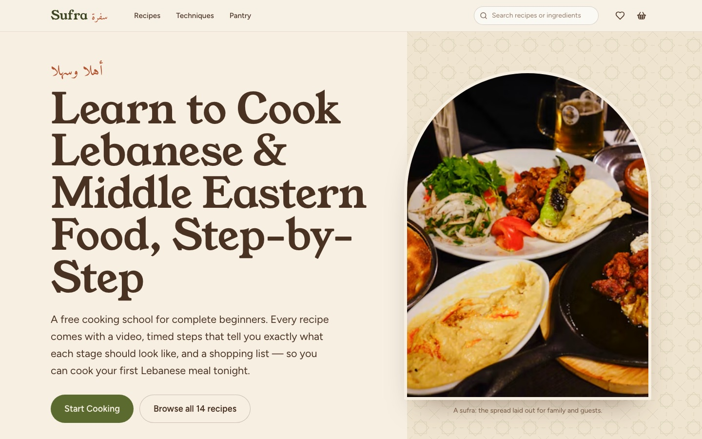
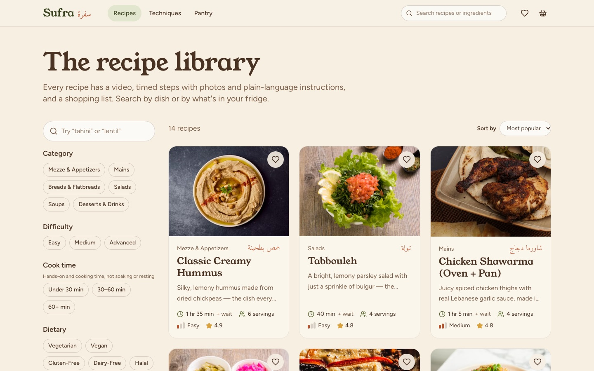
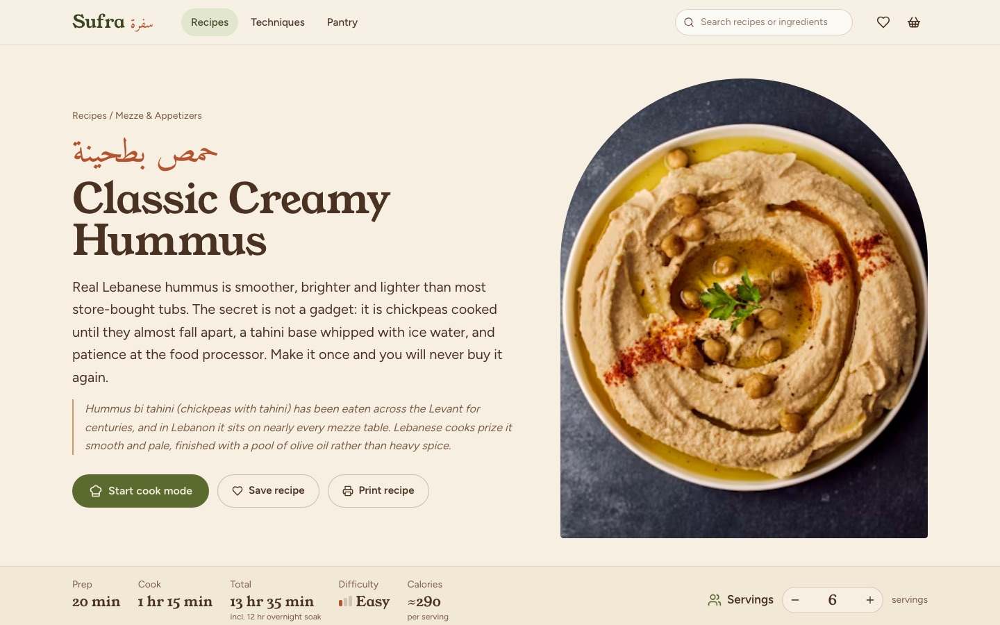
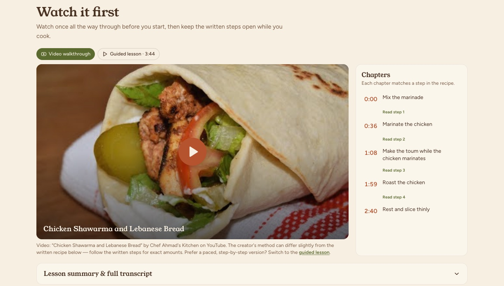
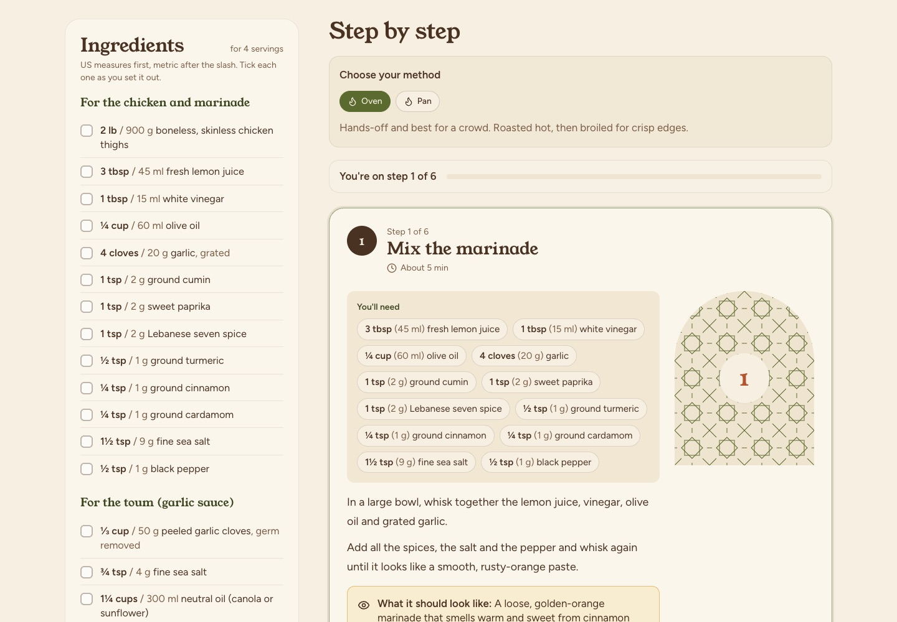
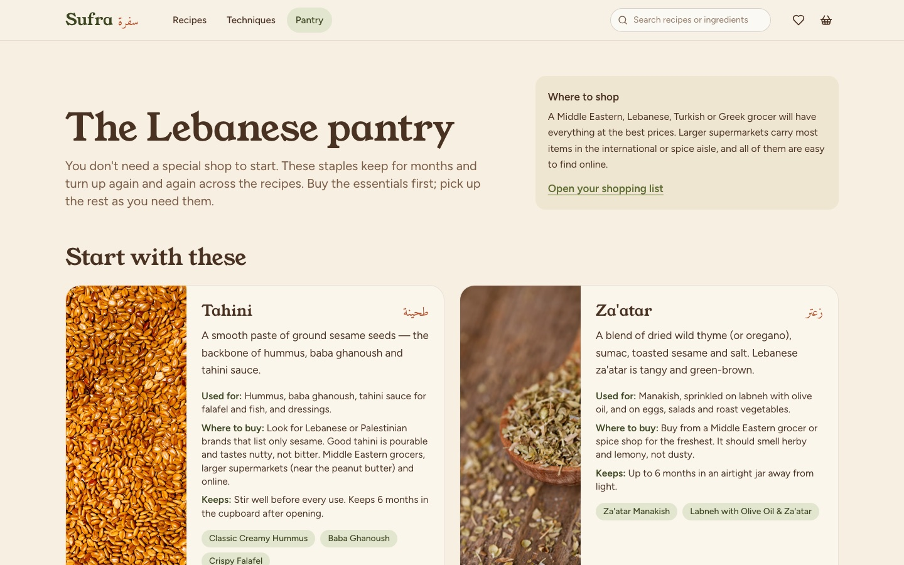
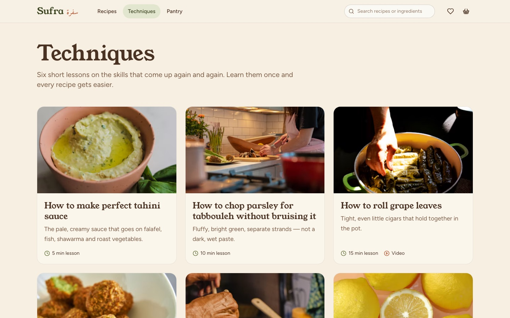
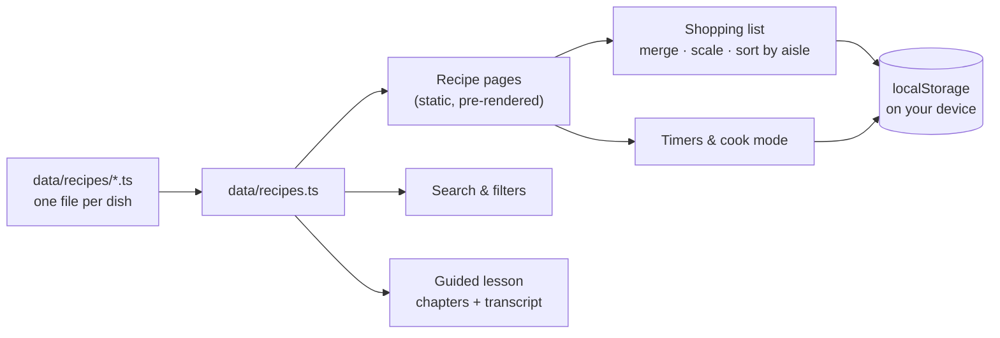

<div align="center">

<h1>
  <sub>سفرة</sub><br/>
  Sufra
</h1>

<h3>A beginner-friendly cooking school for the Lebanese food you grew up on</h3>

<p>
  <em>Sufra (سفرة) is the spread laid out for family and guests.<br/>
  This project is about learning to set one of your own, one dish at a time.</em>
</p>

<p>
  
  
  
  
</p>

<p>
  <a href="#-why-i-built-this">Why</a> ·
  <a href="#-a-look-inside">Tour</a> ·
  <a href="#-the-menu">Recipes</a> ·
  <a href="#-features">Features</a> ·
  <a href="#-run-it-locally">Run it</a> ·
  <a href="#-adding-a-recipe">Add a recipe</a>
</p>



</div>

<br/>

## 🫒 Why I built this

I kept hearing the same thing from people my age. We all grew up eating incredible food at home, the hummus, the warak enab, the Sunday kibbeh, and almost none of us actually knew how to make it. It never mattered while we lived at home, because it was just *there*. Then people left for college or moved out on their own, and suddenly the food they loved most was the food they couldn't cook. Everyone was saying some version of *"I really need to learn how to make my mom's food."*

I felt that too. So I built Sufra.

It is also, honestly, a thank-you to moms. 🤍

Every recipe here is a small window into how much work goes into the food that shows up on the table like it's nothing: soaking chickpeas the night before, rolling a hundred grape leaves by hand, tasting and adjusting until it's *right*. Our moms did that without a recipe, from memory, for years, and made it look easy. Sufra is my attempt to write down what they always just knew, so that the rest of us can carry it with us wherever we end up, and maybe one day cook it for them.

> *Nothing here will ever taste exactly like it does at home. But it can get you close enough to feel like it.*

<br/>

## 🍋 What it is

Sufra is a free, beginner-friendly cooking school for authentic Lebanese and Middle Eastern food. It assumes you have never cooked any of this before. Every recipe tells you not just *what* to do, but **what it should look, smell and feel like** when you've done it right, the tip that makes it work, and the mistake almost everyone makes the first time.

<table>
  <tr>
    <td align="center" width="25%">🎥<br/><b>Watch first</b><br/><sub>A video walkthrough or a guided lesson for every dish</sub></td>
    <td align="center" width="25%">⏱️<br/><b>Timed steps</b><br/><sub>A timer on every timed step that follows you around the site</sub></td>
    <td align="center" width="25%">🛒<br/><b>Smart shopping list</b><br/><sub>Merges, scales and sorts ingredients by store aisle</sub></td>
    <td align="center" width="25%">👩‍🍳<br/><b>Cook mode</b><br/><sub>One step at a time, big text, screen stays awake</sub></td>
  </tr>
</table>

<br/>

## 📸 A look inside

<table>
  <tr>
    <td width="50%"></td>
    <td width="50%"></td>
  </tr>
  <tr>
    <td align="center"><b>The recipe library</b><br/><sub>Search by dish, alternate spelling or what's in your fridge</sub></td>
    <td align="center"><b>Every recipe page</b><br/><sub>Arabic name, a little history, and a servings scaler</sub></td>
  </tr>
  <tr>
    <td width="50%"></td>
    <td width="50%"></td>
  </tr>
  <tr>
    <td align="center"><b>Watch it first</b><br/><sub>Chapters line up with the written steps</sub></td>
    <td align="center"><b>Step by step</b><br/><sub>Exact amounts inside each step, US and metric</sub></td>
  </tr>
  <tr>
    <td width="50%"></td>
    <td width="50%"></td>
  </tr>
  <tr>
    <td align="center"><b>The pantry</b><br/><sub>What to buy, where to find it, how long it keeps</sub></td>
    <td align="center"><b>Techniques</b><br/><sub>The skills that come up again and again</sub></td>
  </tr>
</table>

<br/>

## 🥙 The menu

Fourteen recipes to start, from a five-minute labneh to a full tray of baklava.

| | Dish | | Category | Level | Active time | Plus waiting |
| :-: | :-- | :-: | :-- | :-: | :-: | :-: |
| 🫘 | **Classic Creamy Hummus** | حمص بطحينة | Mezze | 🟢 Easy | 1 hr 35 min | 12 hr soak |
| 🌿 | **Tabbouleh** | تبولة | Salad | 🟢 Easy | 40 min | 20 min |
| 🌯 | **Chicken Shawarma** *(oven or pan)* | شاورما دجاج | Main | 🟡 Medium | 1 hr 5 min | 2 hr marinate |
| 🧆 | **Crispy Falafel** | فلافل | Mezze | 🟡 Medium | 55 min | 18 hr soak |
| 🥧 | **Baked Kibbeh** *(kibbeh bil saniyeh)* | كبة بالصينية | Main | 🔴 Advanced | 1 hr 40 min | 25 min |
| 🫓 | **Za'atar Manakish** | منقوشة زعتر | Bread | 🟡 Medium | 50 min | 1 hr 30 min rise |
| 🥗 | **Fattoush Salad** | فتوش | Salad | 🟢 Easy | 37 min | none |
| 🍆 | **Baba Ghanoush** | متبّل / بابا غنوج | Mezze | 🟢 Easy | 40 min | 20 min |
| 🌶️ | **Muhammara** | محمرة | Mezze | 🟢 Easy | 45 min | 30 min |
| 🥛 | **Labneh with Olive Oil & Za'atar** | لبنة | Mezze | 🟢 Easy | 10 min | 24 hr strain |
| 🍢 | **Kafta** *(skewers or tray bake)* | كفتة | Main | 🟢 Easy | 40 min | 30 min chill |
| 🍲 | **Shorbat Adas** *(lentil soup)* | شوربة عدس | Soup | 🟢 Easy | 55 min | none |
| 🍇 | **Warak Enab** *(stuffed grape leaves)* | ورق عنب بزيت | Mezze | 🔴 Advanced | 2 hr 30 min | 30 min |
| 🍯 | **Baklava** | بقلاوة | Dessert | 🔴 Advanced | 1 hr 40 min | 4 hr cool & soak |

### 🧭 Never cooked before? Start here.

The home page walks you through a six-lesson beginner path, where each dish teaches you something the next one builds on:

```
 1  Labneh            →  two ingredients, five minutes of work. Pure confidence.
 2  Hummus            →  the tahini base that half of Lebanese cooking builds on.
 3  Tabbouleh         →  your first real knife-skills lesson.
 4  Shorbat Adas      →  one pot, pantry staples, big flavour.
 5  Chicken Shawarma  →  marinating, roasting and your first emulsion sauce.
 6  Za'atar Manakish  →  your first yeast dough, start to finish.
```

<br/>

## ✨ Features

<details open>
<summary><b>📖 Recipe pages</b> &nbsp;<sub>(<code>/recipes/[slug]</code>)</sub></summary>
<br/>

- **Servings scaler.** Every ingredient *and* every amount inside the steps updates as you change servings.
- **US and metric** side by side, everywhere.
- **Checkboxes and a progress bar** for ingredients and steps, so you never lose your place.
- **Every step** comes with *what it should look like*, a **pro tip**, and the **common mistake to avoid**.
- **Method switcher** for dishes with two ways to cook them: shawarma in the oven or a pan, kafta on skewers or as a tray bake.
- **Video walkthrough** from YouTube creators (credited on the page), plus a **guided lesson player** with chapters and a full transcript.
- **Equipment list, chef's notes, substitutions, storage, make-ahead tips** and what to serve it with.
- **Pantry check** so you only buy what you're missing.
- **Print recipe** or **print just the ingredients**.
- **Recipe JSON-LD** so search engines understand every page.

</details>

<details>
<summary><b>👩‍🍳 Cook mode</b></summary>
<br/>

One step at a time in large text, with Next / Previous buttons (or the arrow keys). It keeps your screen awake using the Screen Wake Lock API, so you're not tapping your phone with flour on your hands.

</details>

<details>
<summary><b>⏱️ Timers</b></summary>
<br/>

Timers live in a dock that follows you around the site and **survive page reloads**, so an overnight chickpea soak is still counting in the morning. When one finishes it chimes, vibrates and sends a notification.

</details>

<details>
<summary><b>🛒 Shopping list</b> &nbsp;<sub>(<code>/shopping-list</code>)</sub></summary>
<br/>

Add as many recipes as you want and Sufra combines them into one list. Duplicates merge (salt from two recipes becomes one line), amounts scale to your servings, and everything is **sorted by store aisle**. Tick things off as you shop, or share, copy or print the list. *"Add my saved recipes"* pulls in all your favourites at once.

</details>

<details>
<summary><b>🔎 Recipe library</b> &nbsp;<sub>(<code>/recipes</code>)</sub></summary>
<br/>

Search across names, **alternate spellings** (*dolma*, *kofta*, *tabouli* all work), ingredients and categories. Filter by category, difficulty, cook time and diet, and sort by popularity, speed or difficulty. Filters live in the URL, so any view can be shared.

</details>

<details>
<summary><b>🧂 Pantry, 📚 Techniques and ❤️ Saved</b></summary>
<br/>

- **Pantry** (`/pantry`): 16 staples, from tahini and za'atar to pomegranate molasses and orange blossom water, with what they are, what they're for, where to buy them and how long they keep.
- **Techniques** (`/learn`): six short lessons with fixes for common problems:
  - How to make perfect tahini sauce
  - How to chop parsley for tabbouleh without bruising it
  - How to roll grape leaves
  - How to get crispy falafel
  - How to make fluffy pita
  - How to balance lemon, salt and garlic
- **Saved** (`/saved`): your favourite recipes in one place.

</details>

> [!NOTE]
> Everything personal (favourites, shopping list, checkboxes, timers, pantry check) is stored in `localStorage` on your own device. There are no accounts and no backend.

<br/>

## 🚀 Run it locally

```bash
npm install
npm run dev          # http://localhost:3000
```

For production:

```bash
npm run build
npm start
```

> [!TIP]
> Set `NEXT_PUBLIC_SITE_URL` (for example `https://sufra.example.com`) before building for production, so canonical URLs, Open Graph tags and the sitemap use your domain.

| Script | What it does |
| :-- | :-- |
| `npm run dev` | Start the dev server |
| `npm run build` / `npm start` | Production build and server |
| `npm run typecheck` | TypeScript check |
| `npm run lint` | ESLint (Next.js rules + accessibility) |
| `npm run check:data` | Validates the recipe data: ingredient references in steps, method names, pairings, metric amounts |

<br/>

## 🗂️ Project structure

```
sufra/
├── app/                   routes (App Router), sitemap.ts, robots.ts, global CSS
│   ├── recipes/           library + /recipes/[slug]
│   ├── learn/             techniques + /learn/[slug]
│   ├── pantry/
│   ├── shopping-list/
│   └── saved/
├── components/            RecipeCard, StepCard, VideoPlayer, IngredientList,
│                          Timer, ShoppingList, CookMode, LessonVideo, …
├── data/
│   ├── types.ts           the Recipe data model (documented)
│   ├── recipes.ts         recipe list, categories, beginner path
│   ├── recipes/*.ts       one file per recipe
│   ├── pantry.ts          pantry staples
│   └── techniques.ts      technique lessons
├── lib/                   formatting & scaling, search, shopping-list
│                          aggregation, localStorage hooks, lesson timing
└── scripts/
    └── check-data.ts      recipe data validator
```



<br/>

## ➕ Adding a recipe

Got a family recipe that belongs here? Adding one is just a TypeScript file.

1. **Copy** an existing file in `data/recipes/`, e.g. `hummus.ts`.
2. **Ingredients.** Give every ingredient a unique `id`, a US `qty` / `unit` and a `metric` amount. Steps list the ingredients they use in `uses` (with an optional `part`, e.g. `0.5` for half), so amounts appear inside the step and scale with servings.
3. **Steps.** Every step needs a `body`, a `cue` (what it should look, smell or feel like), a `tip` and a `mistake`. Add a `timer` for anything timed.
4. **Two ways to cook it?** Add `methods` and tag the method-specific steps and ingredient groups with `method`.
5. **Register it** in `data/recipes.ts` and run `npm run check:data`.

<br/>

## 📝 Media and content notes

- **Photos** come from Unsplash's CDN (`images.unsplash.com`) through a custom image loader (`lib/unsplashLoader.ts`) that requests the right width and format, so no image optimisation server is needed. A few dishes use a close stand-in photo where Unsplash has no free photo of that exact dish (for example, the baked kibbeh hero shows kibbeh, and manakish shows a herb-topped flatbread). Swap in your own photography by changing `image.src` in the recipe file.
- **Videos** are YouTube embeds from their creators (credited on the page), loaded only when you press play, via `youtube-nocookie.com`. Each was checked to exist and match its dish. Tabbouleh has no embedded video and uses the guided lesson player instead. Creators' methods can differ slightly from the written recipe; the page says so, and the written steps are the reference.
- **Guided lesson** chapters and transcripts are generated from the written steps, so chapters always line up with the recipe. Narration uses the browser's built-in speech voice when one is available and falls back to captions.
- **Ratings** are the editor's kitchen-tested scores set in the recipe data (`rating`), not visitor reviews. "Most popular" ordering uses the `popularity` field. Calories are approximate.

<br/>

<div align="center">

---

<h3>شكراً يا ماما</h3>

<sub><b>Thank you, Mom.</b> For every meal you made look easy.</sub>

<br/><br/>

<sub>صحتين · <i>Sahtein</i> · to your health</sub>

</div>
